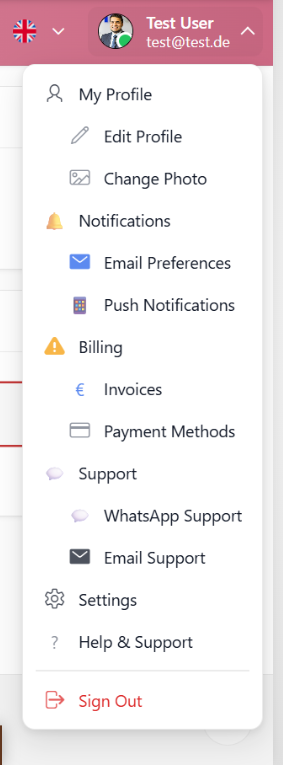
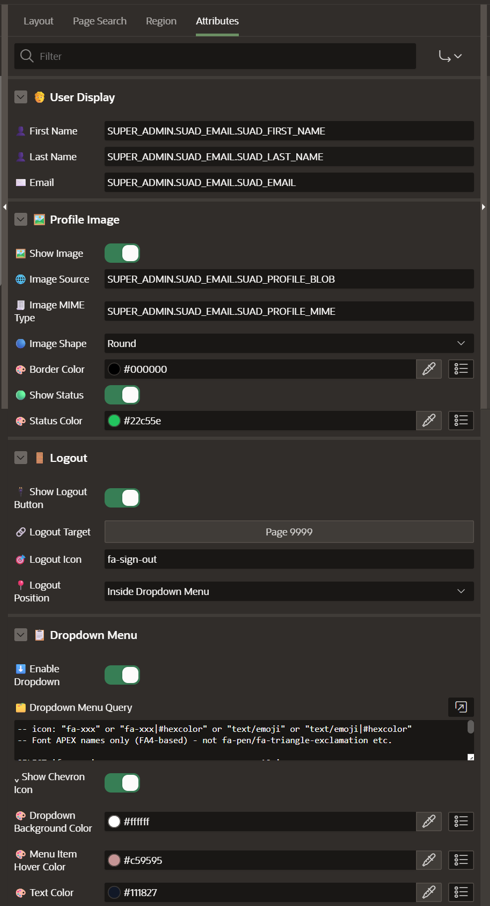

# Profile Bar — Oracle APEX Region Plugin

[](LICENSE)


> A navbar user menu for Oracle APEX: avatar, name and email from the database, a SQL-driven dropdown, and four logout button styles.

<p align="center">
  
</p>

**By Hassaan Ahmed Tahir — Senior Oracle APEX Developer · [Read the full tutorial](https://apexwithhassaan.vercel.app/blog/profile-bar-region-plugin)**

A fully custom, self-contained **Region Plugin** that renders a navbar user menu: the logged-in user's avatar (photo, initials, or a live status dot), name and email, a **query-driven dropdown menu**, and a logout button that can sit inside the dropdown or outside it in any of **four visual styles**.

Instead of cobbling a user menu together from a List region, template overrides and a Dynamic Action or two, Profile Bar does it all from one native APEX region. Name, email and photo can be plain text or live database lookups against the current user, profile photos stored as BLOBs are embedded as Base64, the plugin's own UI strings switch between German and English, and the dropdown items come from your own SQL query.

> ✅ **End result:** A drop-in navbar region — avatar with initials fallback and DB-driven Base64 photo support, a query-driven dropdown menu with icon/text/link/sub-item support, animated open/close, and a logout button with four selectable styles — all from one native APEX region with zero external libraries.

---

## ✨ Features

- **Avatar** — profile photo from a URL or a BLOB column (embedded as Base64, up to 300 KB), initials fallback, optional status dot, three shapes
- **DB-driven identity** — name, email and photo as plain text *or* live `TABLE.MATCH_COLUMN.VALUE_COLUMN` lookups against `APP_USER`
- **SQL-driven dropdown** — icon / text / link / menu type from your own query, with sub-items and per-icon colors
- **Four logout styles** — inside the dropdown or outside as a button, switched purely by CSS class
- **Polished interaction** — swipe-in / swipe-out animation, full keyboard support, portal pattern so no navbar can clip the panel
- **Readable by default** — hover text color is picked automatically from your hover background
- **Bilingual** — the plugin's own strings switch between English and German
- **Zero external libraries** — native PL/SQL, CSS and vanilla JavaScript

---

## 📁 Repository structure

```
apex-profile-bar-plugin/
├── src/
│   ├── profile_bar.sql           # PL/SQL render function (plugin Source)
│   ├── profile_bar.css           # plugin file: styles and animations
│   └── profile_bar.js            # plugin file: SH_USER_MENU behavior
├── docs/images/                  # screenshots used in this README
├── CHANGELOG.md
├── LICENSE                       # MIT
└── README.md
```

> ⚠️ **Note:** To install the plugin into your own APEX workspace, follow the steps below and paste each file into the matching section of the plugin definition — Source, Files (CSS) and Files (JavaScript).

---

## 🚀 Quick install

1. In your APEX app, go to **App Builder → Shared Components → Plug-ins → Create**
2. Create a **Region** plugin named `Profile Bar` (internal name `PROFILE_BAR`)
3. Paste `profile_bar.sql` into the plugin's **Source** and set the render function name to `render`
4. Add the attribute groups and custom attributes listed below
5. Upload `profile_bar.css` and `profile_bar.js` under **Files** and link them under **File URLs to Load**
6. Add a region of type `Profile Bar` to your navigation bar and run the page

---

## 📑 Table of Contents

1. [Create the Plugin (Name, Internal Name, Type)](#1-create-the-plugin-name-internal-name-type)
2. [Add the PL/SQL Render Function](#2-add-the-plsql-render-function)
3. [Set the Callback — Render Function Name](#3-set-the-callback--render-function-name)
4. [Standard Attributes — Leave Them All Off](#4-standard-attributes--leave-them-all-off)
5. [Create the Attribute Groups First](#5-create-the-attribute-groups-first)
6. [Set Up the Custom Attributes](#6-set-up-the-custom-attributes)
7. [Add the CSS File](#7-add-the-css-file)
8. [Add the JavaScript File](#8-add-the-javascript-file)
9. [Link Both Files Under "File URLs to Load"](#9-link-both-files-under-file-urls-to-load)
10. [Apply Changes to the Plugin](#10-apply-changes-to-the-plugin)
11. [Add the Region and Test It](#11-add-the-region-and-test-it)

---

## 1. Create the Plugin (Name, Internal Name, Type)

Head to **Shared Components → Plug-ins → Create**. This time the Type is **Region**, not Item — the plugin renders an entire self-contained block rather than a single form field:

| Field | Value |
|---|---|
| Name | Profile Bar |
| Internal Name | PROFILE_BAR |
| Type | Region |

---

## 2. Add the PL/SQL Render Function

Region plugins use a **function**, not a procedure, returning `apex_plugin.t_region_render_result`. Set the Render Function Type to **PL/SQL Code** and paste the full contents of [`profile_bar.sql`](./src/profile_bar.sql) into the **Source** section.

A few design decisions worth calling out:

- **DB-driven attributes via a naming convention** — First Name, Last Name, Email, Image Source and Image MIME Type each accept either plain literal text or a string like `SUPER_ADMIN.SUAD_EMAIL.SUAD_FIRST_NAME` (table.match-column.value-column). When an attribute matches that pattern, the function runs a dynamic lookup against the current `APP_USER`; otherwise it's used exactly as typed.
- **Base64 avatar embedding** — a profile photo stored as a BLOB is fetched, Base64-encoded via `APEX_WEB_SERVICE.BLOB2CLOBBASE64`, and embedded directly as a `data:` URI — no separate image-serving page needed. Above **300 KB** it silently falls back to initials instead.
- **Bilingual server-side** — the plugin's own fixed strings ("Sign Out", the trigger's aria-label) switch between German and English using `V('BROWSER_LANGUAGE')`.
- **Query-driven dropdown** — the menu items aren't hardcoded. A developer-supplied SQL query returning 4 columns (`icon`, `text`, `link`, `menu_type`) populates the dropdown; if left blank, a small built-in default query renders instead, so the region never appears empty.
- **Links just work** — every dropdown link and the Logout Target go through `apex_plugin_util.replace_substitutions` and `apex_util.prepare_url`, so `&APP_ID.`, `&SESSION.`, `&DEBUG.` and page-item substitutions are resolved and session state checksums are added where needed.
- **Readable hover, automatically** — the hovered item's text color is picked from the *Menu Item Hover Color*: white on a dark hover color, near-black on a light one.

> 💡 **Tip:** Attributes 20 (Width) and 21 (Alignment) are read nowhere in this version — the dropdown panel sizes itself to content (min/max bounds in CSS) instead of a fixed pixel width. If you're rebuilding this from scratch, skip adding those two attributes entirely.

> ✅ **Why the match column is always the same:** `SUAD_EMAIL` is the match column in every DB-driven attribute, because `APP_USER` in this setup is the user's email. Each attribute runs its own independent query, but keeping the match column consistent across all five is what makes them all resolve to the same person.

---

## 3. Set the Callback — Render Function Name

| Field | Value |
|---|---|
| Render Procedure/Function Name | `render` |
| AJAX Procedure/Function Name | — (left empty) |

---

## 4. Standard Attributes — Leave Them All Off

This Region plugin doesn't tick a single Standard Attribute checkbox — no "Region Source supports different Data Sources", no "Page Items to Submit", no "Region Columns". Everything the region needs (user data, image, colors, dropdown query) comes entirely from Custom Attributes, since it's a purely custom-rendered display region rather than one built on a native data source.

---

## 5. Create the Attribute Groups First

With 24 attribute numbers in play (though only 20 are actually wired up — see the tip in Step 2), group them before adding anything:

| Title | Sequence |
|---|---|
| User Display | 10 |
| Profile Image | 20 |
| Logout | 30 |
| Dropdown Menu | 40 |

---

## 6. Set Up the Custom Attributes

Add every Custom Attribute below. The defaults for First Name, Last Name, Email, Image Source and Image MIME Type follow the `TABLE.MATCH_COLUMN.VALUE_COLUMN` convention — a developer can overwrite them with plain literal text instead, and the render function handles both transparently:

| Label | Group | Seq | Attr # | Type | Req. | Default | Depends On |
|---|---|---|---|---|---|---|---|
| First Name | User Display | 100 | 6 | Text | No | `SUPER_ADMIN.SUAD_EMAIL.SUAD_FIRST_NAME` | — |
| Last Name | User Display | 200 | 22 | Text | No | `SUPER_ADMIN.SUAD_EMAIL.SUAD_LAST_NAME` | — |
| Email | User Display | 300 | 7 | Text | No | `SUPER_ADMIN.SUAD_EMAIL.SUAD_EMAIL` | — |
| Show Image | Profile Image | 400 | 1 | Yes/No | No | N | — |
| Image Source | Profile Image | 500 | 2 | Text | Yes | `SUPER_ADMIN.SUAD_EMAIL.SUAD_PROFILE_BLOB` | Profile Image – Show Image |
| Image MIME Type | Profile Image | 600 | 23 | Text | Yes | `SUPER_ADMIN.SUAD_EMAIL.SUAD_PROFILE_MIME` | Profile Image – Show Image |
| Image Shape | Profile Image | 700 | 3 | Select List | No | ROUND / SQUARE / ROUNDED | Profile Image – Show Image |
| Border Color | Profile Image | 800 | 5 | Color | No | `#000000` | Profile Image – Show Image |
| Show Status | Profile Image | 900 | 8 | Yes/No | No | N | Profile Image – Show Image |
| Status Color | Profile Image | 1000 | 9 | Color | No | `#22C55E` | Profile Image – Show Status |
| Show Logout Button | Logout | 100 | 10 | Yes/No | No | N | — |
| Logout Target | Logout | 200 | 11 | Link to Target Page/URL | No | — | Logout – Show Logout Button |
| Logout Icon | Logout | 300 | 12 | Text | No | `fa-sign-out` | Logout – Show Logout Button |
| Logout Position | Logout | 400 | 13 | Select List | No | OUTSIDE / INSIDE | Logout – Show Logout Button |
| Logout Style | Logout | 500 | 24 | Select List | Yes | STYLE1 | Logout – Show Logout Button |
| Enable Dropdown | Dropdown Menu | 100 | 14 | Yes/No | No | Y | — |
| Dropdown Menu Query | Dropdown Menu | 200 | 15 | SQL Query | No | see note below | Dropdown Menu – Enable Dropdown |
| Show Chevron Icon | Dropdown Menu | 300 | 16 | Yes/No | No | Y | Dropdown Menu – Enable Dropdown |
| Dropdown Background Color | Dropdown Menu | 400 | 17 | Color | No | `#FFFFFF` | Dropdown Menu – Enable Dropdown |
| Menu Item Hover Color | Dropdown Menu | 500 | 18 | Color | No | `#F3F4F6` | Dropdown Menu – Enable Dropdown |
| Text Color | Dropdown Menu | 600 | 19 | Color | No | `#111827` | Dropdown Menu – Enable Dropdown |

> 💡 **Good to know:**
> - **Show Status** draws the dot on the avatar, so it depends on **Show Image** = Yes.
> - **Image MIME Type** accepts a `TABLE.MATCH.VALUE` lookup *or* a literal value such as `image/jpeg`. Anything that isn't a valid `image/...` type falls back to `image/png`.
> - **Logout Target** can be any page or URL, including substitutions (`&APP_ID.`, `&SESSION.`). Left empty, it uses APEX's built-in `LOGOUT` request.
> - **Logout Icon** left empty falls back to `fa-sign-out`.
> - **Logout Position = Inside** needs the dropdown. If **Enable Dropdown** is No, the logout button is shown outside instead, so it never disappears.
> - **Menu Item Hover Color** also sets the hover text color automatically (white or near-black), so any color you pick stays readable.
> - Attribute 4 (avatar size) is optional — if you don't add it, the avatar is 28 px.

> ✅ **Dropdown Menu Query default:** if left blank, the render function falls back to its own built-in 2-item query (Settings + Campus Administrator, both pointing at placeholder pages). The moment you supply your own SQL — returning `icon`, `dropdown_text`, `link`, `menu_type` in that order — it fully replaces the default, including support for sub-items (`menu_type = 'SUB'`, indented) and per-icon colors (`fa-star|#F59E0B`).

---

## 7. Add the CSS File

Under **Files**, create `profile_bar.css` and paste the contents of [`profile_bar.css`](./src/profile_bar.css).

The most interesting pieces are the **four logout button style variants** — all switched purely by a CSS class, no JS involvement — and the **swipe-in / swipe-out** keyframe animations for the dropdown panel:

| Style | Look |
|---|---|
| `STYLE1` | Icon only, ghost hover (the original default) |
| `STYLE2` | Icon only, outlined circle always visible |
| `STYLE3` | Icon + text, ghost hover |
| `STYLE4` | Solid red filled button, icon + text |

---

## 8. Add the JavaScript File

Now create `profile_bar.js` and paste the contents of [`profile_bar.js`](./src/profile_bar.js).

The whole thing is wrapped in a `SH_USER_MENU` namespace with a single `init(wrapperId)` entry point, called once per region instance from the render function's `apex_javascript.add_onload_code`. Three details worth flagging:

- **Portal pattern** — the dropdown panel is moved to `<body>` on init, so no navbar's `overflow: hidden` can ever clip it.
- **Animated close needs a delay, not an instant class swap** — closing adds `is-closing`, waits for the CSS animation to finish (300 ms, tracked via `setTimeout`), then removes it. Removing the class immediately would strip the animation before the browser ever painted a frame.
- **Re-init guard** — an `initialized` map keyed by wrapper ID means calling `init()` again never double-binds the same event listeners.

Full keyboard support is built in: **Enter / Space / ↓** open the menu, **↑ / ↓** move between items, **Enter** activates, **Escape** closes and returns focus, and **Tab** closes the panel.

---

## 9. Link Both Files Under "File URLs to Load"

| Field | Value |
|---|---|
| Cascading Style Sheet | `#PLUGIN_FILES#profile_bar#MIN#.css` |
| JavaScript | `#PLUGIN_FILES#profile_bar#MIN#.js` |

---

## 10. Apply Changes to the Plugin

Click **Apply Changes** — the plugin is now registered as a selectable Region type anywhere in the application.

> ✅ We're finished with the plugin itself. Everything from here is about placing it on a real page.

---

## 11. Add the Region and Test It

Create a new Region on your page — typically in the navigation bar area of a template, or a dedicated position like **Global Page → Navigation Bar**. Set its **Type** to `Profile Bar`.

Here's a real working configuration to start from:

| Attribute | Value |
|---|---|
| First Name | `SUPER_ADMIN.SUAD_EMAIL.SUAD_FIRST_NAME` |
| Last Name | `SUPER_ADMIN.SUAD_EMAIL.SUAD_LAST_NAME` |
| Email | `SUPER_ADMIN.SUAD_EMAIL.SUAD_EMAIL` |
| Show Image | Yes |
| Image Source | `SUPER_ADMIN.SUAD_EMAIL.SUAD_PROFILE_BLOB` |
| Image MIME Type | `SUPER_ADMIN.SUAD_EMAIL.SUAD_PROFILE_MIME` |
| Image Shape | Round |
| Show Status | Yes |
| Show Logout Button | Yes |
| Logout Icon | `fa-sign-out` |
| Logout Position | Inside Dropdown Menu |
| Enable Dropdown | Yes |

With **Logout Position** set to *Inside Dropdown Menu*, the Sign Out row renders as the last item in the panel — separated from the rest by a thin divider — instead of as its own icon button next to the avatar.

Once the basics work, swap in your own dropdown SQL — for example:

```sql
SELECT 'fa-user'          AS icon, 'My Profile'       AS dropdown_text, 'f?p=&APP_ID.:10:&SESSION.::::' AS link, 'MAIN' AS menu_type FROM dual
UNION ALL
SELECT 'fa-pen|#3B82F6', 'Edit Profile', 'f?p=&APP_ID.:11:&SESSION.::::', 'SUB' FROM dual
UNION ALL
SELECT 'fa-bell', 'Notifications', 'f?p=&APP_ID.:12:&SESSION.::::', 'MAIN' FROM dual
```

Save and run the page. Click the avatar — the panel swipes in from the right with a slight overshoot, menu items highlight on hover, sub-items sit indented, and Escape or an outside click swipes it back out smoothly rather than just vanishing.

---

## Why This Approach Works So Well

- **One naming convention, two behaviors** — First Name, Last Name, Email, Image Source and Image MIME Type each work as either a literal value or a live DB lookup, just by matching (or not matching) the `TABLE.MATCH.VALUE` pattern — no separate toggle attribute needed
- **Query-driven, not hardcoded** — the dropdown menu is entirely defined by a developer-supplied SQL query, with a sensible built-in fallback so the region is never empty on first drop
- **Four logout styles, zero JS branching** — the visual variant is controlled purely by which CSS class gets attached, driven by one Select List attribute
- **Portal + proper animation timing** — the panel lives in `<body>` so no navbar can clip it, and closing waits out its own CSS animation instead of snapping the class off mid-frame
- **Graceful image handling** — a profile photo above 300 KB silently falls back to initials rather than bloating the page or throwing an error
- **Safe defaults everywhere** — links resolve substitutions, hover text stays readable with any color, and the logout button never disappears whatever combination of settings is chosen

---

## 📸 Screenshots

<p align="center">
  <br>
  <em>The finished result — dropdown open, Sign Out inside the panel</em>
</p>

<p align="center">
  <br>
  <em>The Page Designer configuration behind it — every attribute set once</em>
</p>

---

That's the full build — from an empty region plugin to a production-ready user menu with DB-driven identity, Base64 avatars, a fully custom dropdown, and four logout button looks to choose from. If you build this into your own navbar, feel free to open an issue and share which Logout Style you go with!

---

## 📝 Changelog

See [CHANGELOG.md](CHANGELOG.md) for the full version history.

---

## 📄 License

Released under the [MIT License](LICENSE) — free to use, modify and redistribute in personal and commercial projects.

---

## 🙏 Credits

Built by **Hassaan Ahmed Tahir** — Senior Oracle APEX Developer.
Special thanks to **Sajjad Hanifa** for his continued guidance and support in shaping these features and building them right.

📌 Read the full step-by-step write-up on **[APEX with Hassaan](https://apexwithhassaan.vercel.app/blog/profile-bar-region-plugin)**, and keep an eye on the blog for more Oracle APEX plugins and tutorials.
